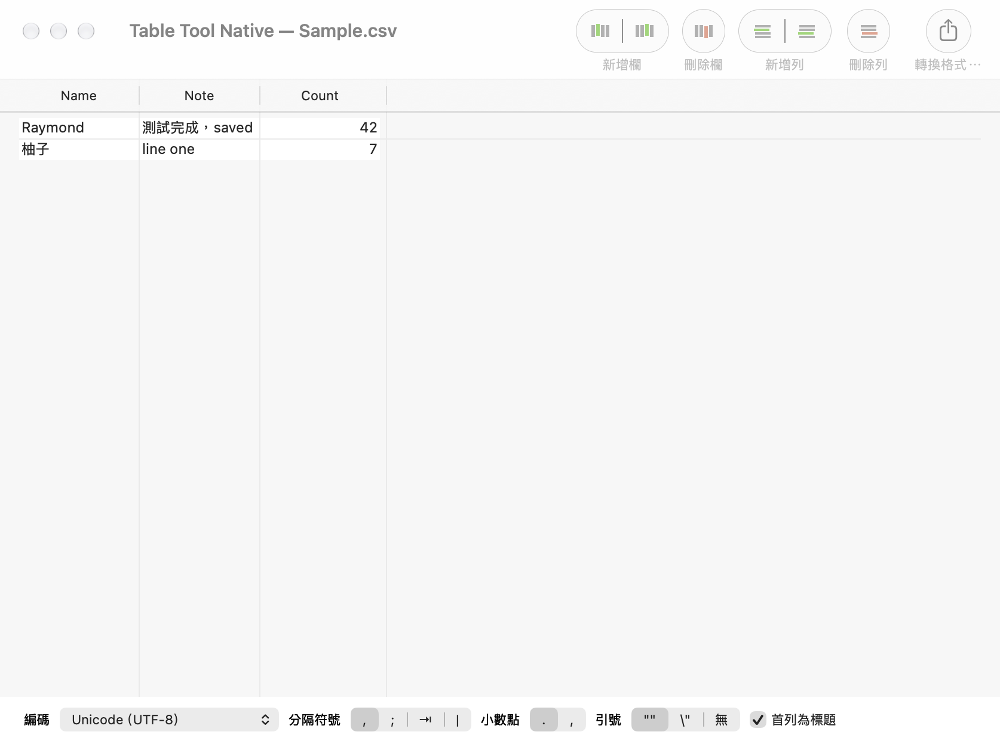

# Table Tool Native

A small, native CSV editor for Apple Silicon Macs, with **English and Traditional Chinese** interfaces.

[繁體中文說明](docs/README.zh-Hant.md) · [Download](https://github.com/Raymondhou0917/TableTool/releases) · [Upstream and credits](docs/UPSTREAM.md)

This is a community fork of [jakob/TableTool](https://github.com/jakob/TableTool), not the official App Store release. The original MIT license and author attribution are preserved. Andrea Brugnoli's existing [Apple Silicon PR #112](https://github.com/jakob/TableTool/pull/112) is included with its original author; this fork builds on that work rather than claiming a new ARM port from scratch.

## What changed

- Reproducible **arm64** build with a current Xcode; no Rosetta needed for this app.
- English and Traditional Chinese menus, toolbar labels, format settings, undo actions, and error messages.
- **Language** menu: System Default, English, or 繁體中文. Save documents and reopen the app after changing it.
- Traditional Chinese **Big5** added to the encoding menu.
- Separate name (**Table Tool Native**) and bundle ID, so the original app can stay installed.
- Regression coverage for Big5, localized format controls, and a real document open/edit/save/reopen workflow, alongside the original tests.



## Install

Download the `arm64.zip` from [Releases](https://github.com/Raymondhou0917/TableTool/releases), unzip it, and copy **Table Tool Native.app** to Applications.

The release uses **ad-hoc signing and is not Apple-notarized**. macOS may require approval for this individual downloaded app in System Settings → Privacy & Security. Do not disable Gatekeeper globally. You can also build from source.

The deployment target is **macOS 12+**; runtime validation was performed on an **M4 Pro running macOS 27**. Other macOS versions have not been runtime-tested for this fork. This focused release uses the original light/Aqua appearance so its legacy custom cells and toolbar artwork remain readable.

## Build and test

Install full Xcode and select its developer directory. No package manager dependencies, API keys, or network services are needed by the app.

```sh
bash scripts/build.sh
bash scripts/test.sh
```

The app is written to `build/Release-arm64/Build/Products/Release/Table Tool Native.app`, and the ZIP to `dist/`. Tests run in both interface languages on the host architecture and attach native AppKit window snapshots to the result bundles.

## CSV behavior

Open, edit, add/remove/reorder rows and columns, undo, choose encoding and delimiters, and convert CSV files. The app reads and writes user-selected local files; it has no built-in analytics or cloud upload.

The upstream CSV engine automatically infers numeric values. **Numeric formatting, including leading zeroes, may be normalized.** Keep the original file and check converted copies when working with identifiers or account numbers. This release changes compatibility and localization, not that underlying parsing policy.

## Credits and license

Original Table Tool: **Sandro Peham, Andreas Aigner, and Jakob Egger**. Apple Silicon compatibility updates: **Andrea Brugnoli**. Traditional Chinese localization, build/release tooling, and integration tests: **Raymond Hou and contributors**.

MIT license; see [LICENSE](LICENSE). See [docs/UPSTREAM.md](docs/UPSTREAM.md) for the provenance and scope of this fork.
